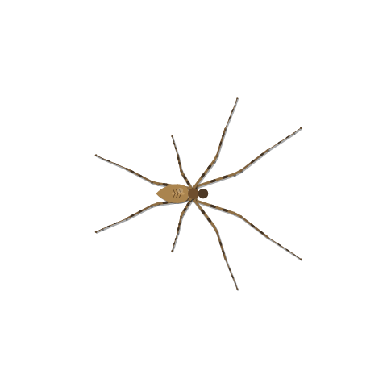

# Silkstride · 丝行

A tiny articulated spider that wanders your Windows desktop.
一只会在 Windows 桌面自主游走、可以拎起脚尖的关节蜘蛛。

[English](#english) · [简体中文](#简体中文) · [Download / 下载](https://github.com/lisniuse/silkstride/releases/latest) · [MIT](LICENSE)

<p align="center"></p>

## English

Silkstride is a native **C++17 / Win32 / GDI+** desktop pet for Windows 10/11 x64.
Eight articulated legs, a shared Verlet physics body, rainbow colors, and a small
behavior system bring it to life. No browser engine, third-party runtime, or admin
rights required. Startup with Windows is enabled on the first normal launch.

### Download and run

Download `Silkstride-windows-x64.zip` from [Releases](https://github.com/lisniuse/silkstride/releases/latest),
extract it, and launch `Silkstride.exe`. The release executable is unsigned.
Look for its spider icon in the system tray, including the hidden-icons overflow.
Only one instance runs at a time.

**Recycle Bin feeding permanently deletes real files. It is enabled by default.**
To disable it, uncheck **Eat Recycle Bin files (permanently delete one at a time)**
in the tray menu. Use disposable files when trying this feature.

### What it does

- **Walks with its feet.** Four segments per leg, distance and angle constraints,
  planted contacts, alternating steps, and an inertial body.
- **Can be picked up.** Hold any foot tip with the left mouse button. The other
  legs flail while the body hangs from your pointer. Release gently or fling it;
  it lands and recovers its footing. Other desktop clicks pass through.
- **Has a daily rhythm.** Explores, observes, approaches cautiously, retreats from
  fast incoming mouse movement, rests in corners, and grooms its legs.
- **Remembers interactions.** Personality, energy, trust, fear, hunger, and visited
  regions persist across restarts. It gradually calms down after being handled.
- **Gets hungry.** Ordinary movement slows at high hunger. A hungry spider can
  approach a visible Recycle Bin filename and chew before consuming that file.
- **Speaks English and Chinese.** The initial language follows Windows UI language
  (Chinese for Chinese locales; English otherwise). Change it in
  **Language / 语言 → English / 简体中文**; your choice is saved immediately.

### Controls

| Action | Control |
| --- | --- |
| Pick up / drag | Left-drag any foot tip |
| Throw / put down | Release the left mouse button |
| Put down without throwing | `Esc` while holding |
| Pause / resume | `Ctrl+Alt+S`, or double-click the tray icon |
| Quit | `Ctrl+Alt+Q`, or the tray menu |
| Speed, size, rainbow, mouse following, monitor | Right-click the tray icon |
| Show / hide hunger panel | Tray → **Show hunger panel** |
| Change language | Tray → **Language / 语言** |
| Start with Windows | Tray → **Start with Windows** (enabled on first launch) |

The hunger panel starts **hidden on every launch**. The tray tooltip and menu
still show hunger and energy. Hiding the panel does not pause feeding.
Speed, size, pause, and panel visibility reset on launch; language, personality,
memory, hunger, and the feeding toggle persist.

### Start with Windows

The first normal launch (including the first launch after upgrading from v0.1.0)
adds a per-user Windows sign-in startup entry. Uncheck **Start with Windows** in
the tray menu to remove it. Later launches respect your choice and do not add it
back. Diagnostic modes never configure real startup entries.

Registration uses the `Silkstride` value under
`HKEY_CURRENT_USER\Software\Microsoft\Windows\CurrentVersion\Run`; a first-run
marker is stored under `HKEY_CURRENT_USER\Software\Silkstride`. No administrator
rights are needed. Keep the executable at its registered location; after moving
it, toggle startup off and on to update the path. Before removing the portable
app, turn startup off to remove its entry. Windows may delay startup or override
it through its own startup-app controls.

### Hunger and feeding

Hunger ranges from 0 to 100 and starts at 20 for a new pet. It rises by **3 points
per minute** during ordinary activity, or **1.5 points per minute** while resting
or grooming. It does not rise while paused or closed. Above 65, ordinary movement
slows; at 80 it starts seeking food, continuing until hunger is 5 or lower.

It only targets a visible, exposed, genuine Windows Recycle Bin folder view on
the pet's monitor. It locates an actual filename, walks close, and chews for about
4 seconds. Each confirmed permanent deletion reduces hunger by 15 points. It
rechecks file identity, visibility, position, and body distance before deleting;
scrolling, sorting, or moving the window makes it locate the target again.

Directories are excluded. It never empties the whole bin, recursively deletes
folders, reads file contents, or executes files. Ambiguous, unavailable, or failed
targets are skipped. Closing, minimizing, covering, or switching away from the
view, pausing, picking up the pet, or disabling feeding cancels pending feeding.
A deletion that has already completed cannot be undone.

### Local data

The app uses these files under `%LOCALAPPDATA%\NeonSpider\`:

| File | Contents |
| --- | --- |
| `creature.state` | Personality, needs, interaction memory, hunger, feeding toggle |
| `ui.settings` | Chosen interface language |

`NeonSpider` is the pre-release data-directory name, retained to preserve existing
pets. The app works locally and has no telemetry or network dependency. It samples
mouse movement for behavior and uses Shell/UI Automation to locate visible
Recycle Bin items. Personal state and test outputs are excluded from this repo.

### Build

Install **Visual Studio 2022** with **Desktop development with C++**, a Windows
SDK, and **PowerShell 7**. No external C++ libraries are needed.

```powershell
git clone https://github.com/lisniuse/silkstride.git
cd silkstride
pwsh -NoProfile -File ./build.ps1
./build/Silkstride.exe
```

The script builds x64 Release with a static C++ runtime. CMake 3.20+ is also
supported:

```powershell
cmake -S . -B out/cmake -G "Visual Studio 17 2022" -A x64
cmake --build out/cmake --config Release
./out/cmake/Release/Silkstride.exe
```

### Diagnostics and contributing

`build/` contains the runnable executable; compiler objects go to `out/obj/`.
Exit the running pet before diagnostics, then run:

```powershell
pwsh -NoProfile -File ./test.ps1
# Or select a suite:
pwsh -NoProfile -File ./test.ps1 -Suite startup
```

Reports and preview images go to `out/tests/`; the script fails if a diagnostic
fails or does not produce a report. For the manual arguments below, run
`../../build/Silkstride.exe` from `out/tests/` so outputs stay outside `build/`.

| Argument | Coverage |
| --- | --- |
| `--motion-test` | Walking, planted feet, turn stability, contact-driven body movement |
| `--interaction-test` | All eight legs at three sizes: drag, flail, throw, land |
| `--behavior-test` | Fear, curiosity, rest, memory, two-minute physical simulation |
| `--feeding-test` | Mock feeding, interruption, filename approach, persistence; no real deletions |
| `--i18n-test` | Both catalogs, state labels, locale fallback, preference serialization, panel previews |
| `--startup-test` | First-launch registration, opt-out persistence, quoted paths, isolated registry cleanup |
| `--smoke-test` | Real window, tray, and hook; exits after three seconds |
| `--preview` | Export `preview.png` without starting autonomous behavior |
| `--input-test` | Moves the cursor and exercises real mouse input; restores cursor position |
| `--recycle-probe` | Read-only view and filename-coordinate inspection |
| `--feeding-canary-test` | Recycles and permanently deletes only its own fresh GUID-named disposable file |

The canary test requires a visible Recycle Bin window, may select/scroll to its
test file, and leaves that file in the bin if validation fails. It never enables
ordinary feeding or submits pre-existing files for deletion. Diagnostic modes do
not load or overwrite pet memory. The startup test uses its own temporary GUID
registry subtree and never modifies real startup entries. CI runs the six
non-destructive suites and uploads the Windows executable and reports.

See [AGENTS.md](AGENTS.md) for contributor conventions. **Commit messages must use
Conventional Commits**, e.g. `feat(i18n): add a translation`.

### Credits and license

The walking mechanics were inspired by [Rainbow Spider by run-time](https://codepen.io/run-time/pen/abYeqZ),
particularly its contact order and Verlet distance/angle constraints. Silkstride
implements these ideas in native C++ with desktop input, autonomy, persistence,
and Shell integration. See [THIRD_PARTY_NOTICES.md](THIRD_PARTY_NOTICES.md).

Released under the [MIT License](LICENSE).

## 简体中文

丝行（Silkstride）是一个原生 **C++17 / Win32 / GDI+** 桌面宠物，支持 Windows
10/11 x64。八条四段关节腿与身体共享 Verlet 物理系统，支持循环彩虹配色和自主行为。
无需浏览器引擎、额外运行库或管理员权限。首次正常运行默认加入开机启动。

### 下载与运行

从 [Releases](https://github.com/lisniuse/silkstride/releases/latest) 下载
`Silkstride-windows-x64.zip`，解压后运行 `Silkstride.exe`。发布程序未做数字签名。
右下角系统托盘中有蜘蛛图标，可能收在“隐藏的图标”中。程序同时只运行一个实例。

**回收站进食会永久删除真实文件，默认开启。** 可在托盘取消勾选
**回收站进食（逐个永久删除文件）**。体验此功能时请使用一次性测试文件。

### 功能

- **用脚牵动身体行走**：四段关节、距离和角度约束、固定落脚点、交替换脚，身体有惯性。
- **抓脚、挣扎和甩动**：左键按住任意脚尖，身体悬挂，其他七条腿自由挣扎。轻放或甩出后，
  它会落地并恢复支撑。其他桌面点击正常穿透。
- **自主生活节奏**：探索、停下观察、好奇靠近、躲避快速逼近的鼠标、去角落休息、整理腿脚。
- **性格与互动记忆**：性格、精力、信任、警觉、饥饿和探索记录跨重启保留，被抓后会逐渐平静。
- **饥饿与进食**：饥饿时普通行动变慢，可以爬到回收站里实际可见的文件名附近咀嚼并吃掉文件。
- **中英文界面**：首次按 Windows 界面语言选择（中文系统使用简体中文，其余使用 English），
  可在 **Language / 语言 → 简体中文 / English** 切换，立即保存偏好。

### 操作

| 操作 | 方式 |
| --- | --- |
| 拎起、拖动 | 左键按住任意脚尖 |
| 甩出、轻放 | 松开左键 |
| 不带甩动地放下 | 抓住时按 `Esc` |
| 暂停、继续 | `Ctrl+Alt+S` 或双击托盘图标 |
| 退出 | `Ctrl+Alt+Q` 或托盘菜单 |
| 速度、大小、彩虹配色、跟随鼠标、切换屏幕 | 右键托盘图标 |
| 显示、隐藏饥饿面板 | 托盘 → **显示饥饿提示面板** |
| 切换语言 | 托盘 → **Language / 语言** |
| 开机启动 | 托盘 → **开机启动**（首次运行默认开启） |

饥饿面板**每次启动默认隐藏**，托盘提示和菜单仍可查看饥饿与精力。隐藏面板不影响进食。
速度、大小、暂停和面板显示状态在启动时重置；语言、性格、记忆、饥饿和进食开关会保留。

### 开机启动

首次正常运行（包括从 v0.1.0 升级后第一次运行）会自动添加当前用户登录 Windows 时的
启动项。右键托盘取消勾选 **开机启动** 即可移除；之后再次运行会尊重选择，不会自动加回来。
所有诊断模式都不会配置真实启动项。

启动项为注册表 `HKEY_CURRENT_USER\Software\Microsoft\Windows\CurrentVersion\Run`
下的 `Silkstride` 值，首次配置标记保存在 `HKEY_CURRENT_USER\Software\Silkstride`，
无需管理员权限。请保持程序所在位置不变；移动后关闭再开启此选项即可更新路径。删除便携版
程序前可先关闭此选项以移除启动项。Windows 可能延后启动，系统自己的启动应用设置也可能
覆盖此行为。

### 饥饿与回收站进食

饥饿值为 0～100，新宠物初始为 20。普通活动每分钟增加 **3 点**，休息或整理腿脚时每分钟
增加 **1.5 点**。暂停或关闭时不增长。超过 65 后普通移动变慢，达到 80 开始寻找食物，
持续进食直到饥饿不高于 5。

它只会寻找所在屏幕上可见、未被遮住的真实 Windows 回收站视图。先定位文件名，爬近并停稳，
咀嚼约 4 秒。每成功永久删除一个文件，饥饿减少 15 点。删除前再次核对文件身份、可见性、
位置和身体距离；滚动、排序或移动窗口时会重新定位。

不吃文件夹，不清空整个回收站，不递归删除目录，不读取文件内容，不执行文件。无法明确定位、
无法访问或处理失败的条目会跳过。关闭、最小化、遮住或切走回收站视图，暂停、抓走蜘蛛或
关闭进食开关，会中止尚未执行的进食。已经完成的永久删除无法撤回。

### 本地数据

存档位于 `%LOCALAPPDATA%\NeonSpider\`：

| 文件 | 内容 |
| --- | --- |
| `creature.state` | 性格、需求、互动记忆、饥饿和进食开关 |
| `ui.settings` | 界面语言偏好 |

`NeonSpider` 是早期版本的数据目录名，为保留原有宠物继续使用。程序在本地运行，无遥测或
联网依赖；采样鼠标移动用于行为判断，通过 Shell 与 UI Automation 定位可见回收站条目。
个人存档和测试输出不进入源码仓库。

### 编译

安装 **Visual Studio 2022** 的“**使用 C++ 的桌面开发**”组件、Windows SDK 和
**PowerShell 7**。无需额外 C++ 依赖。

```powershell
git clone https://github.com/lisniuse/silkstride.git
cd silkstride
pwsh -NoProfile -File ./build.ps1
./build/Silkstride.exe
```

脚本生成 x64 Release，静态链接 C++ 运行库。也支持 CMake 3.20+：

```powershell
cmake -S . -B out/cmake -G "Visual Studio 17 2022" -A x64
cmake --build out/cmake --config Release
./out/cmake/Release/Silkstride.exe
```

### 验证与贡献

`build/` 只放可运行程序，编译中间文件放在 `out/obj/`。先退出运行中的宠物，再执行：

```powershell
pwsh -NoProfile -File ./test.ps1
# 也可只选择一组：
pwsh -NoProfile -File ./test.ps1 -Suite startup
```

报告和预览图统一输出到 `out/tests/`，测试失败或没有生成报告时脚本报错。手动使用下列
参数时，也请从 `out/tests/` 运行 `../../build/Silkstride.exe`，避免污染 `build/`。

| 参数 | 验证内容 |
| --- | --- |
| `--motion-test` | 步态、脚点固定、转向稳定、脚点驱动身体 |
| `--interaction-test` | 八条腿 × 三种大小：拖拽、挣扎、甩动和落地 |
| `--behavior-test` | 警觉、好奇、休息、记忆和两分钟真实物理模拟 |
| `--feeding-test` | 模拟进食、中断、靠近文件名和存档；不删除真实文件 |
| `--i18n-test` | 中英文文案、行为标签、语言回退、偏好序列化和面板预览 |
| `--startup-test` | 首次注册、关闭后不重建、路径引号和隔离注册表清理 |
| `--smoke-test` | 实际窗口、托盘与钩子，三秒后退出 |
| `--preview` | 导出 `preview.png`，不启动自主行为 |
| `--input-test` | 短暂移动鼠标，验证真实输入，结束后恢复光标 |
| `--recycle-probe` | 只读检查实际回收站窗口和文件名坐标 |
| `--feeding-canary-test` | 仅回收并永久删除自己新建的 GUID 一次性测试文件 |

Canary 测试要求真实回收站窗口可见，会选中并滚动到自己的测试条目；失败时可能将测试文件
留在回收站。它不会开启日常进食或提交原有文件进行删除。诊断模式不加载或覆盖宠物存档。
开机启动测试使用自己临时创建的 GUID 注册表子树，不修改真实启动项。CI 运行六组
无破坏性的检查，并上传 Windows 程序和报告。

贡献约定见 [AGENTS.md](AGENTS.md)。**提交信息必须使用 Conventional Commits（CC）风格**，
例如 `feat(i18n): add a translation`。

### 致谢与协议

行走机制参考 [run-time 的 Rainbow Spider](https://codepen.io/run-time/pen/abYeqZ)，
尤其是换脚顺序和 Verlet 距离、角度约束。丝行使用原生 C++ 实现，并加入桌面交互、自主行为、
记忆和 Shell 集成。详见 [THIRD_PARTY_NOTICES.md](THIRD_PARTY_NOTICES.md)。

本项目采用 [MIT 协议](LICENSE)。
